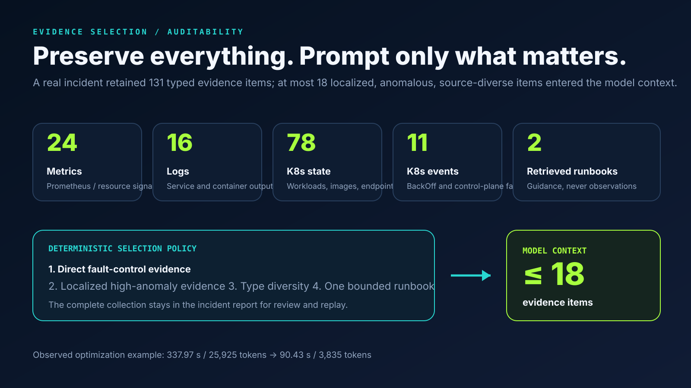
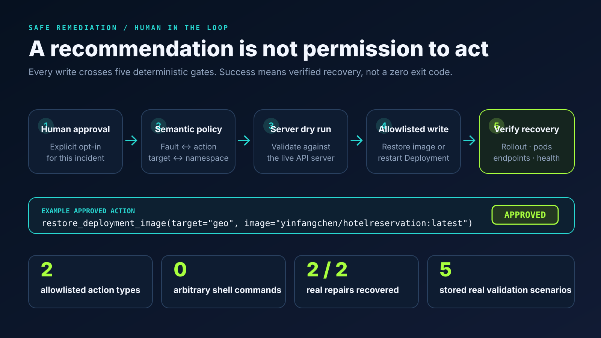

# EvidenceOps: Engineering Case Study

## Project question

Can a local language model diagnose microservice incidents from real cluster evidence without being trusted with arbitrary write access?

EvidenceOps explores that question through a complete AIOps loop on a local Kubernetes environment. It uses AIOpsLab to deploy the Hotel Reservation application and inject faults, gathers heterogeneous telemetry, produces an auditable diagnosis, and executes only narrowly allowlisted repairs after human approval.

## What I built

I designed and implemented the system end to end:

- a provider abstraction for real AIOpsLab experiments and deterministic offline regression;
- a typed evidence layer spanning Prometheus metrics, logs, Kubernetes state/events, and runbooks;
- detection and localization logic that prioritizes direct control-plane evidence over noisy downstream symptoms;
- a dependency-graph ranker that discounts propagated caller symptoms and exposes per-service scores;
- an OpenAI-compatible diagnosis engine with bounded evidence selection and validated JSON output;
- confidence temperature scaling, low-confidence abstention, and model-comparison tooling;
- a deterministic evidence-only baseline for reproducible testing;
- a remediation policy with explicit approval, semantic allowlists, dry runs, and recovery verification;
- a CLI, Streamlit dashboard, structured incident reports, evaluation pipeline, and visual results;
- ARM64 and local-path compatibility fixes needed to run the upstream stack reliably on macOS.

## System design

The agent separates probabilistic reasoning from deterministic control.

1. **Detect.** A signal detector evaluates anomaly scores and stability gates.
2. **Localize.** Direct evidence is combined with distance-discounted symptoms from callers in the service dependency graph.
3. **Diagnose.** The model receives at most 18 localized, anomalous, source-diverse evidence items plus at most one relevant runbook; its raw confidence is temperature-scaled and may produce an abstention.
4. **Plan.** Model output is parsed into a strict Pydantic schema and normalized to a four-class fault taxonomy.
5. **Approve.** Diagnosis mode cannot write. Repair mode still requires explicit approval.
6. **Execute.** The policy requires a typed context, observed evidence, sufficient confidence, topology agreement, and incident/action compatibility before a server-side dry run.
7. **Verify.** Rollout success alone is insufficient; active pods, endpoints, image state, and health signals must recover.
8. **Report.** JSON and Markdown reports retain the complete evidence and phase trace.

## Technical decisions

### Preserve full evidence, bound only the prompt

A real cluster produced more than 130 evidence items. Sending all of them to a local 14B model made the relevant fault signal compete with healthy inventory and caused high latency. EvidenceOps keeps the full collection in the incident artifact but selects a bounded prompt using service locality, anomaly score, evidence type, and runbook quotas.

This reduced one observed run from 337.97 seconds and 25,925 tokens to 90.43 seconds and 3,835 tokens without discarding audit evidence.

### Make the baseline evidence-only

AIOpsLab scenario identifiers contain strings such as `network_delay` or `pod_failure`. Reading those IDs inside the diagnosis baseline would leak the ground truth. The current baseline deliberately ignores `problem_id`, infers the class from evidence, and has a regression test with a misleading scenario name.

### Treat actions as a typed safety protocol

The model never constructs arbitrary commands. It may recommend only a typed action. The control layer accepts two automatic actions under known conditions:

- restore the `geo` Deployment to a known-good image for an image-misconfiguration incident;
- restart the `user` Deployment for a pod-failure incident.

Network faults remain recommendation-only. A model misclassification cannot bypass the incident/action compatibility check.

### Separate engineering regression from model validation

The deterministic suite contains 24 executions but only five unique scenario templates. It validates code paths, metrics, and reproducibility; it is not presented as 24 independent model examples. Real-cluster model validation contains four fault classes and one healthy control. The evaluator reports unique scenario counts, repeated run counts, and Wilson intervals to make this boundary visible.

### Treat uncertainty as a system decision

EvidenceOps stores both raw and temperature-scaled confidence. A configurable threshold converts low-confidence diagnoses into explicit abstentions, which removes action proposals and independently blocks writes. The evaluator reports coverage, selective accuracy, ECE, Brier score, and a reliability diagram. A separate command fits the temperature on a calibration split and warns that final calibration claims require an untouched test split.

### Compare models under one contract

The comparison runner evaluates the rule baseline and named OpenAI-compatible models against the same suite, evidence budget, fault taxonomy, and metrics. It emits per-model artifacts plus JSON, CSV, and Markdown summaries of accuracy, coverage, calibration, latency, tokens, and errors.

### Use model failures to improve the evidence boundary

In the first local Qwen 2.5 14B pilot, the pod-failure prompt included both the correct runbook and a lower-ranked image-misconfiguration runbook. Qwen chose the distractor class with 0.99 confidence and proposed an inconsistent image repair. The safety policy would have rejected the action because its root cause, target, and operation disagreed. I changed retrieval to one evidence-matched runbook, added transparent direct-phrase boosts, skipped model calls for detector-confirmed healthy windows, and fixed cumulative token accounting. The identical five-template rerun then produced all expected decisions.

## Problems solved during implementation

- **Noisy evidence:** healthy pod inventory crowded out the fault signal; solved with localized, type-diverse evidence budgeting.
- **Root cause vs. symptom:** a bad image caused restarts and temporarily unready pods; direct image evidence now outranks restart symptoms.
- **Stale telemetry:** historical logs incorrectly localized network incidents; active Chaos resources receive higher precedence.
- **False positives during startup:** stabilization windows, stale-event filtering, and conservative generic-counter scoring protect the healthy control.
- **Unsafe dry run:** `kubectl rollout restart` lacks the required dry-run behavior; the implementation uses an equivalent server-side patch dry run.
- **Recovery race:** terminating old pods made a successful rollout look unhealthy; verification ignores terminating pods and checks the active replica set.
- **Local environment reliability:** Docker restarts removed `/run/udev` inside the Kind node; the provider restores it and repairs the affected OpenEBS DaemonSet state.
- **ARM64 compatibility:** upstream image and local-path assumptions required minimal, recorded patches rather than an untracked fork.

## Results

The new topology-aware validation snapshot contains five real AIOpsLab + Qwen runs:

| Scenario | Detection | Localization | Root cause | Remediation |
|---|---|---|---|---|
| Faulty application image | Correct | `geo` | image misconfiguration | approved rollback verified healthy |
| Pod failure | Correct | `user` | pod failure | approved restart verified healthy |
| Network packet loss | Correct | `user` | packet loss | recommendation only |
| Network delay | Correct | `user` | network delay | recommendation only |
| Healthy control | No alert | — | — | no write |

The topology-aware real runs produced 5/5 expected final decisions, 4/4 correct service
localizations, and 4/4 correct root-cause classes. Mean end-to-end time was 90.69 seconds across all
five cases (97.80 seconds across faults), with 15,072 total model tokens; the healthy path used zero
model tokens. The Fixture pilot independently produced 5/5 expected decisions with 20.456 seconds
mean latency and 4,566 total tokens. These are integration results, not generalization claims. All
46 automated tests pass, including topology ranking, abstention, calibration, report provenance,
structured safety context, failure paths, evidence selection, anti-leakage, distractor retrieval,
and token accounting.

## Limitations and next steps

The real validation set is intentionally small and uses one application, one local cluster topology, one model, and four supported fault classes. The deterministic fixtures repeat five templates and therefore measure regression stability rather than statistical generalization. The response times are hardware- and model-specific.

The new real runs exercise the topology and confidence-reporting extension, but do not isolate its
causal benefit because there is only one run per condition and no real-cluster ablation. The most
valuable next steps would be:

1. run repeated real experiments with varied fault magnitudes, timing, and workload load;
2. add unrelated distractor faults and multi-fault incidents;
3. run multiple local and hosted models through the implemented comparison contract;
4. fit calibration on a grouped calibration split and report ECE/Brier on a held-out test split;
5. add OpenTelemetry traces and learn or validate causal dependency weights;
6. package the deployment as a reproducible CI or cloud-based experiment environment.

These limitations are part of the project story: the goal is not to claim a production-ready autonomous operator, but to demonstrate a careful, testable architecture for trustworthy LLM-assisted operations.
