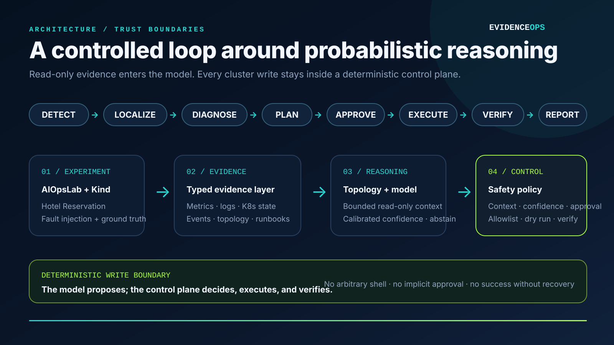

# EvidenceOps

**An evidence-driven AIOps agent for explainable diagnosis and human-approved Kubernetes remediation.**

Project owner: **Haozhe Cui (崔皓哲)**

EvidenceOps turns metrics, logs, Kubernetes state, events, and operational runbooks into a structured incident report. It follows a deterministic control loop:

`DETECT → LOCALIZE → DIAGNOSE → PLAN → APPROVE → EXECUTE → VERIFY → REPORT`

The central design choice is a strict boundary between reasoning and action. The language model can interpret read-only evidence, but it cannot run shell commands or write to the cluster. Any remediation must pass a semantic allowlist, explicit human approval, a server-side dry run, and post-action health verification.



## Why this project matters

LLM-based operations tools are easy to demo and difficult to trust. EvidenceOps focuses on the difficult parts:

- grounding a diagnosis in multiple observable sources;
- keeping the full evidence trail while bounding the model context;
- preventing scenario-label leakage in offline baselines;
- separating downstream symptoms from candidate root services with a dependency graph;
- quantifying uncertainty through calibration, selective prediction, and explicit abstention;
- enforcing least-privilege, human-in-the-loop remediation;
- distinguishing a successful command from an actually recovered service;
- separating deterministic regression results from real-cluster LLM validation.

## Validation snapshot

| Track | Scope | Result | Interpretation |
|---|---:|---:|---|
| Topology-aware real AIOpsLab + Qwen | 4 fault types + 1 healthy control | 5/5 decisions; 4/4 localization and root cause | New end-to-end research snapshot; one run per condition |
| Approved real remediation | image rollback + Deployment restart | 2/2 recovered | Both passed rollout, readiness, endpoint, and health checks |
| Local-model research pilot | Qwen 2.5 14B, 5 unique Fixture templates | 5/5 final decisions | Failure-driven integration pilot; not a generalization benchmark |
| Deterministic regression | 24 runs over 5 unique scenario templates | 24/24 passed | Engineering regression only; repeated runs are not independent cases |
| Automated tests | agent, topology, calibration, safety, LLM, evaluation | 46 passing | Includes report provenance, anti-leakage, abstention, distractor retrieval, and per-run token tests |

The new real-cluster research snapshot used Microsoft AIOpsLab, the Hotel Reservation application,
Kind, and local `qwen2.5:14b`. Mean end-to-end time was **90.69 s** over five cases (**97.80 s**
over faults), with **15,072 total model tokens**. The healthy control stopped before the LLM and used
zero tokens. Exact run IDs and report hashes are included in the curated result manifest.

> Results are deliberately scoped. The five real scenarios show end-to-end feasibility; they do not establish production-grade generalization. See [Case Study](CASE_STUDY.md#limitations-and-next-steps).

## Core capabilities

- AIOpsLab provider plus a deterministic fixture provider for local development.
- Metrics, logs, Kubernetes state/events, and BM25-retrieved runbooks normalized as typed `EvidenceItem` objects.
- OpenAI-compatible model interface with deterministic JSON validation and bounded, source-diverse evidence selection.
- Evidence-only rule baseline that never reads the ground-truth-bearing scenario ID.
- Dependency-aware service ranking that separates direct anomalies from discounted caller symptoms.
- Structured `IncidentReport` output with raw/calibrated confidence, abstention, topology scores, evidence IDs, risk, and phase trace.
- Multi-model comparison under one evidence/metric contract, with coverage, selective accuracy, ECE, Brier score, latency, and token use.
- Two allowlisted writes: restart a known Deployment or restore a known-good image.
- Namespace, target, container, image, typed incident context, confidence, topology agreement, approval, and dry-run checks.
- CLI, Streamlit dashboard, batch evaluation, reliability diagrams, response-time charts, and Wilson confidence intervals.

## Quick start: offline path

Requirements: Python 3.11 or 3.12.

```bash
python3.11 -m venv .venv
source .venv/bin/activate
pip install -e '.[dev]'

python -m evidenceops doctor
pytest -q

python -m evidenceops run \
  --problem misconfig_app_hotel_res-detection-1 \
  --provider fixture --engine rule

streamlit run dashboard/app.py
```

The fixture path is deterministic and does not require Docker, Kubernetes, or an API key. It is intended for software regression, not model-performance claims.

## Research evaluation path

Compare a non-LLM baseline and OpenAI-compatible models with the same evidence and metrics:

```bash
python -m evidenceops compare \
  --models rule,qwen2.5:7b,qwen2.5:14b \
  --suite configs/cases.yaml --provider fixture \
  --output results/comparison
```

Fit temperature scaling on a dedicated calibration split:

```bash
python -m evidenceops fit-calibration \
  --records results/calibration/records-full.csv \
  --output results/confidence-calibration.json
```

Apply the emitted `CONFIDENCE_TEMPERATURE` before evaluating an untouched test split. Low calibrated
confidence triggers an explicit abstention and blocks writes. The complete experimental contract is
in [docs/research-evaluation.md](docs/research-evaluation.md).

The completed local pilot is documented in
[results/research-pilot/PILOT_REPORT.md](results/research-pilot/PILOT_REPORT.md). Qwen initially made
a 0.99-confidence pod-failure misdiagnosis after seeing a lower-ranked distractor runbook; the safety
policy rejected the inconsistent repair. Restricting retrieval to one evidence-matched runbook led
to 5/5 expected final decisions, 20.456 s mean latency, and 4,566 total tokens. These are five Fixture
templates and are deliberately not presented as a model benchmark.

The topology-aware real-cluster rerun is documented in
[results/real/research-upgrade/REAL_RESEARCH_SNAPSHOT.md](results/real/research-upgrade/REAL_RESEARCH_SNAPSHOT.md).
Its summary artifacts can be regenerated from saved reports with `summarize-reports`; the command
records the newest-successful selection policy and a SHA-256 hash for every source report.

## Real-cluster path

Requirements: Docker Desktop, Kind, `kubectl`, Helm, approximately 8 CPU / 16 GB RAM, and either Ollama or another OpenAI-compatible endpoint.

```bash
cp .env.example .env
./scripts/fetch_aiopslab.sh
./scripts/configure_aiopslab.sh
./scripts/create_kind_cluster.sh

python -m evidenceops run \
  --problem misconfig_app_hotel_res-detection-1 \
  --provider aiopslab --engine api
```

Example local-model configuration:

```dotenv
LLM_BASE_URL=http://127.0.0.1:11434/v1
LLM_API_KEY=ollama
LLM_MODEL=qwen2.5:14b
LLM_MAX_EVIDENCE_ITEMS=18
LLM_MAX_SUMMARY_CHARS=600
```

Secrets belong in `.env`, which is ignored by Git.

## Safe remediation

Diagnosis is read-only by default. A repair requires both `--mode repair` and `--approve`:

```bash
python -m evidenceops run \
  --problem pod_failure_hotel_res-detection-1 \
  --mode repair --approve \
  --provider fixture --engine rule
```

The state machine, rather than the model, owns every write. It checks the action against the diagnosed fault class, target namespace, resource name, and image allowlist; performs a dry run; executes the approved action; then verifies rollout, readiness, endpoints, and service health.


## Repository map

```text
evidenceops/        agent, providers, evidence model, LLM adapter, safety policy
dashboard/          Streamlit incident console
configs/            regression, topology, ablation, repair, and Kind configuration
knowledge/          operational runbooks used by BM25 retrieval
tests/              unit and integration tests
scripts/            environment and AIOpsLab setup helpers
results/            curated validation summaries and figures
assets/             architecture and safety diagrams
```

For the engineering decisions, failures encountered, and limitations, read
[CASE_STUDY.md](CASE_STUDY.md).

The new five-run real-cluster snapshot exercises topology-aware localization and confidence
reporting. It supports end-to-end feasibility, but its single run per condition is still too small
for comparative or calibration claims.

## Technology

Python, Pydantic, Typer, Streamlit, LangChain tool interfaces, BM25, HTTPX, Pandas, scikit-learn, Kubernetes, Kind, Helm, Prometheus, Chaos Mesh, Microsoft AIOpsLab, Ollama, and Qwen 2.5.
