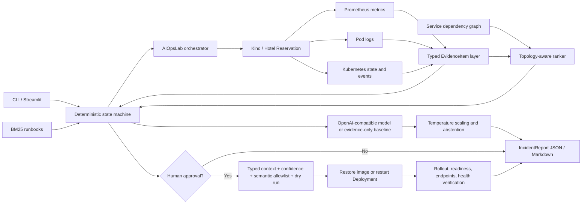

# Architecture

The language model receives normalized read-only evidence. It never executes a command. The state machine crosses the write boundary only after explicit approval, observed-evidence support, confidence and topology agreement, and policy validation.
